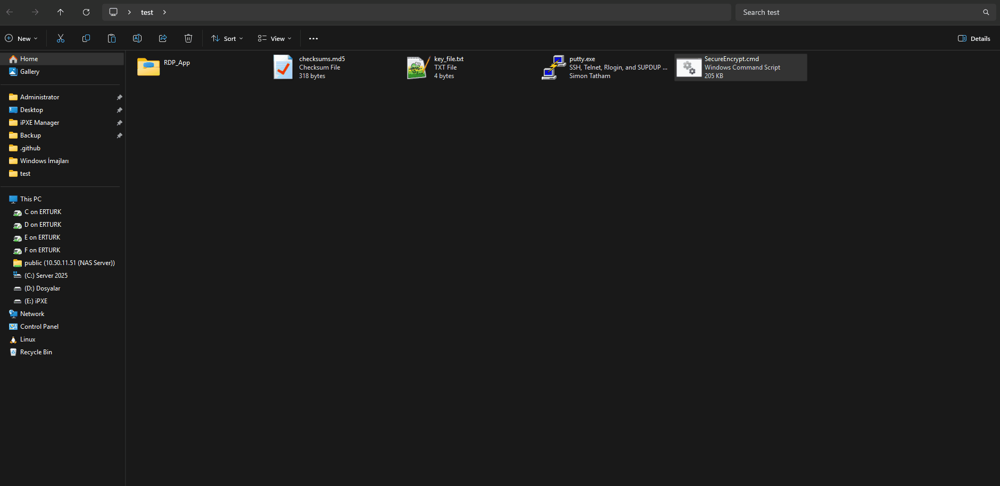
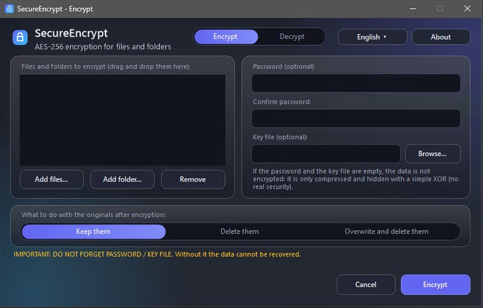

  
# SecureEncrypt v7
**SecureEncrypt (AES-256 Encrypt & Decrypt)**

Dosya ve klasörleri isteğe bağlı **AES-256 parola / anahtar dosyası koruması** ile kendi kendini açabilen tek bir `.cmd` arşivine dönüştüren bir Windows betiği.

A Windows script that converts **files and folders** into a single, self-extracting `.cmd` archive, with optional **AES-256 password / key file protection**.

---

<strong>Türkçe Tanıtım</strong>

---

## Proje Hakkında

Bir veya birden fazla dosyayı/klasörü alıp, onları kendi kendini çözebilen (self-extracting) tek bir Windows komut dosyasına (`*_decrypt.cmd`) dönüştürür. Bu dosyayı Windows 7, 8.1, 10, 11 veya Server üzerinde çalıştırdığınızda (parola/anahtar dosyası varsa onları sorar) içeriği güvenle geri çıkarır. Harici yazılım gerekmez.

**3. parti uygulama gerekmez:** AES-256 şifreleme, PBKDF2, HMAC ve GZip tamamen **Windows'un yerleşik bileşenleriyle** yapılır: `cmd`, Windows PowerShell ve .NET Framework'ün kendi `System.Security.Cryptography` / `System.IO.Compression` sınıfları (yardımcı kod, Windows ile gelen C# derleyicisiyle çalışma anında derlenir). 7-Zip, OpenSSL, GPG gibi bir şey kurmanız, indirmeniz veya internete bağlanmanız gerekmez; şifreleme algoritmasının kendisi de elle yazılmamıştır, Windows'un standart kriptografi kütüphanesi kullanılır.

**Şifreli dosyayı birine göndermek:** Şifreli bir dosyayı başkasına gönderdiğinizde, dosyayı oluşturan programın karşı tarafta da kurulu olması gerekmez. Birçok şifreleme aracında (7-Zip, VeraCrypt, GPG gibi) alıcının da aynı programı kurması gerekir, yoksa dosya açılamaz. Burada çözücü `_decrypt.cmd` dosyasının **içindedir** ve yalnızca Windows'un kendi bileşenlerini (`cmd`, PowerShell, .NET Framework) kullanır. Alıcı dosyaya çift tıklar, parolayı yazar ve içerik çıkar; hiçbir şey kurması, indirmesi ya da internete bağlanması gerekmez. Windows kullanmayan alıcılar için tarayıcı sürümü vardır (aşağıdaki "Tarayıcı sürümü" bölümüne bakın).

## ✨ Özellikler

**Şifreleme ve güvenlik**
* **Yerleşik Windows şifrelemesi:** AES-256, PBKDF2 ve HMAC-SHA256 için .NET Framework'ün kriptografi sınıfları kullanılır; 3. parti araç veya kütüphane yoktur.
* **AES-256-CBC + HMAC-SHA256 (Encrypt-then-MAC):** Dosya değiştirilmiş veya bozulmuşsa çözme **hiçbir şey yazmadan** reddedilir.
* **PBKDF2-HMAC-SHA256, 600.000 yineleme** ile anahtar türetme (yineleme sayısı dosyanın içinde saklanır). Rastgele 16 bayt salt ve IV.
* **Parola doğrulama (iki kez sorulur) ve parola gücü göstergesi.** Zayıf parolada uyarı verilir.
* **Anahtar dosyası (keyfile) desteği:** Parola yerine, ya da parolayla birlikte herhangi bir dosya anahtar olarak kullanılabilir (iki faktör). Anahtar dosyası sorulduğunda yolu yazabilir, dosyayı pencereye sürükleyebilir ya da **`?` yazıp "Dosya seç" penceresinden** seçebilirsiniz (sürükle-bırak çalışmayan yönetici pencerelerinde ve Server işletim sistemlerinde işe yarar; Server Core'da pencere açılamazsa yolu yazın). Bu özellik denenmiş ve çalıştığı görülmüştür.
* **Parola komut satırında geçmez**; `SecureString` olarak okunur, ara tamponlar kullanıldıktan sonra sıfırlanır. Özel karakterli (`& ! % " '`) parolalar sorunsuz çalışır.
* **Orijinal SHA256 özeti şifreli verinin içinde saklanır** (artık `_decrypt.cmd` içinde düz yazılı değildir).
* **Çözücüde 3 deneme hakkı;** yanlış parola anında (tüm dosyayı çözmeden) anlaşılır.
* **Güvenli çıkarma:** Arşiv içindeki yollar denetlenir (`..` ile klasör dışına yazma engellenir).
* **Betik Bütünlük Koruması:** `SecureEncrypt.cmd` çalışmadan önce kendi SHA256 imzasını kontrol eder (değişiklik tespiti içindir, saldırgana karşı koruma değildir).
* **Gelişmiş Sistem Dizin Koruması:** `C:\Windows`, `C:\Program Files`, `$Recycle.Bin`, `System Volume Information` vb. şifrelenemez. Yalnızca kullanıcı profiliniz ve sistem diski dışındaki diskler güvenlidir.

**Kullanım kolaylığı**
* **Şifreyi çözme sekmesi:** `SecureEncrypt.cmd` penceresinde "Şifrele / Şifreyi çöz" sekmeleri vardır. "Şifreyi çöz" sekmesinde bir `_decrypt.cmd` dosyası seçilir ya da pencereye bırakılır (tek bir `_decrypt.cmd` dosyasını `SecureEncrypt.cmd` üzerine bırakmak da bu sekmeyi o dosyayla açar). 4 GB'tan büyük dosyalar için de bu yol kullanılabilir.
* **Çoklu dosya/klasör:** Aynı anda birden fazlasını sürükleyip bırakın ya da sağ tıkla seçin; hepsi tek `_decrypt.cmd` içinde toplanır.
* **Sağ tık menüsü:** Dosya, klasör ve karışık seçimler için tek bir *Şifrele* girdisi, `*_decrypt.cmd` dosyaları için *Şifreyi Çöz*. Çoklu seçimde Explorer her öğe için ayrı işlem başlatır; küçük bir yardımcı (`C:\Windows\SecureEncrypt.js`, pencere açmaz) Explorer'a o penceredeki **seçimin tamamını** sorar ve hepsini **tek bir pencerede** işler (süreye bağlı değildir, tek dosyada da bekleme olmaz). Seçim alınamazsa (örneğin masaüstü) kuyruk yöntemi kullanılır: geç gelenler siz parolayı yazarken ana pencereye eklenir ("Seçilen N öğe daha eklendi"), çok geç kalanlar ayrı pencerede açılır, hiçbir öğe kaybolmaz. Windows Script Host kapalıysa yerleşik kuyruk yöntemi kullanılır.
* **Klasör sorulmaz:** şifrelerken `_decrypt.cmd` kaynağın yanına yazılır, çözerken içerik `_decrypt.cmd` dosyasının bulunduğu klasöre çıkar.
* **Orijinalleri silme seçeneği:** Önce çıktı çözülüp karşılaştırılarak **doğrulanır**, sonra onayınızla silinir; isterseniz üzerine yazılarak (SSD'lerde garanti vermez).
* **Çakışma yönetimi:** Hedefte aynı ad varsa üzerine yaz / yeniden adlandır / atla / iptal.
* **Orijinal değişiklik tarihi ve öznitelikler korunur**; boş klasörler de şifrelenir.
* **Otomatik GZip sıkıştırma** (zaten sıkıştırılmış türler hariç).
* **Modern pencere arayüzü:** Şifreleme, çözme ve kurulum arkası bulanık (buzlu cam) bir pencerede yapılır; Windows 7'den 11'e aynı çalışır. Pencere açılamayan sistemlerde (örneğin Server Core) konsol arayüzü kullanılır. Konsolu zorlamak için `/console` veya `set SE_GUI=0`.
* **Windows 11 yeni sağ tık menüsü:** Windows 11 22H2 ve üstünde **Kur / Güncelle** klasik menü girdilerinin yanında SecureEncrypt'i yeni menüye de ekler (`"Daha fazla seçenek göster`" demeden; üstte simgeli ``SecureEncrypt`` girdisi, altında **Şifrele** / **Şifreyi Çöz**, çoklu seçimde de çalışır). Windows bunu yalnızca paket kimliği olan uygulamalara izin verdiği için kurulum, yönetici izniyle küçük bir **imzasız deneme paketi** (`Add-AppxPackage -AllowUnsigned`) kaydeder ve `C:\Program Files\SecureEncrypt` içine küçük bir yardımcı program (`SecureEncryptShell.exe`, `.cmd` içindeki gömülü C# kodundan derlenir) koyar. Bu yöntem Windows'un test amaçlı yoludur; desteklenmezse kurulum klasik menüyle sorunsuz tamamlanır ve pencerede belirtilir. **Kaldır** her şeyi geri alır.
* **Çok dilli, dil dosyalarından:** Hazır diller: **Türkçe, İngilizce, Almanca, İspanyolca, Fransızca, İtalyanca, Hollandaca, Rusça ve Ukraynaca** (tarayıcı sürümü de aynı dilleri destekler). Metinler `src\lang\` içindeki `tr.ini`, `en.ini`, `de.ini`, `es.ini`, `fr.ini`, `it.ini`, `nl.ini`, `ru.ini`, `uk.ini` gibi ayrı dosyalardadır. Windows diline göre açılır, pencerenin sağ üstündeki seçimden değiştirilebilir (seçim kaydedilir). Sağ tık menüsündeki yazılar kurulum sırasında yazıldığı için, dili değiştirdikten sonra menüyü yeni dilde görmek için kurulumdaki "Güncelle" seçeneğini kullanın. Zorlamak için `set SE_LANG=tr` (veya `en`, `de`, `es`, ...). Yeni dil eklemek için aşağıdaki "Yeni dil ekleme" bölümüne bakın.
* **Unicode desteği:** Dosya ve klasör adları ile parola her dilde olabilir (Çince, Japonca, Korece, Arapça, Kiril, Türkçe vb.); adlar ve parola Unicode olarak işlenir, çözerken aynen geri gelir. Betik dosyası tamamen ASCII olduğundan Windows'un sistem dil / kod sayfası ayarı fark etmez. Kullanıcı adı veya `%TEMP%` yolunda sistemin kod sayfasında olmayan karakterler olsa bile çalışır (derleme gerekirse geçici olarak ASCII bir klasöre alınır). Not: Konsol yazı tipi bazı karakterleri ekranda `?` veya kutu olarak gösterebilir, bu yalnızca görüntüdür, işlemi etkilemez. Soruları cevaplarken (`e/h`, `y/n`) klavye düzeni Latin olmalıdır. Bu destek, farklı kod sayfaları (`chcp`) ve Unicode adlarla denenmiştir; gerçek Çince/Japonca/Korece/Arapça Windows kurulumunda denenmemiştir.
* **Akış tabanlı işleme:** Çok büyük dosyalar bellek hatası vermeden işlenir; ilerleme çubuğu gösterilir.
* **Kendi kendini çözen:** Veri ve çözme mantığı tek `.cmd` dosyasındadır (salt okunur oluşturulur).
* **Klasörler için ZIP/Shell.Application gerekmez;** kendi kapsayıcı biçimi kullanılır, bu yüzden Windows 7'de de aynı şekilde çalışır.

**Parolasız mod:** Parola ve anahtar dosyası girilmezse veri **şifrelenmez**; yalnızca sıkıştırılır ve XOR ile gizlenir (düz metin olarak görünmez ama bu güvenlik sağlamaz).

## 🚀 Nasıl Kullanılır?

### Kurulum (isteğe bağlı)
1. `SecureEncrypt.cmd` dosyasını indirip **çift tıklayın**, UAC'ye "Evet" seçin.
2. Kurulum sorusuna **E** seçin. Sağ tık menüsüne *Şifrele* (dosya ve klasör) ve `*_decrypt.cmd` için *Şifreyi Çöz* eklenir.
3. Güncellemek veya kaldırmak için betiği yeniden çalıştırın (1 = güncelle, 2 = kaldır).

### Şifreleme
* **Sağ tık** ile (kurulum gerekir) ya da bir veya daha fazla dosya/klasörü `SecureEncrypt.cmd` üzerine **sürükleyip bırakarak** (kurulum gerekmez).
* Varsayılan akış kısadır: **Parola** (Enter = atla) → **Parola doğrulama** → **Gelişmiş seçenekler? [e/H]**. Enter ile geçerseniz şifreleme hemen başlar, çıktı kaynağın yanına yazılır ve orijinaller kalır. **E** derseniz sırayla **Anahtar dosyası** ve **Orijinaller** (N / D / S) sorulur. D veya S seçerseniz çıktı doğrulandıktan sonra orijinaller ek onay istenmeden silinir.
* Çıktı: `Ad_decrypt.cmd` (birden fazla öğede `Ad_and_N_more_decrypt.cmd`).

### Çözme
`..._decrypt.cmd` dosyasını çift tıklayın (veya sağ tık → *Şifreyi Çöz*). Gerekirse parola ve/veya anahtar dosyası sorulur; içerik, dosyanın bulunduğu klasöre çıkarılır. Sonunda SHA256 doğrulaması gösterilir.

## 🔒 Güvenlik Modeli: Şifrem Kırılabilir mi?

Güvenlik, seçtiğiniz parolanın (ve/veya anahtar dosyasının) gücüne **bağlıdır**.

* **Algoritma (AES-256): Kırılamaz.** Saldırgan algoritmayı değil, *parolanızı tahmin etmeyi* dener.
* **PBKDF2 (600.000 yineleme)** her tahmini yavaşlatır, ama zayıf parolayı kurtarmaz.

| Şifre Gücü | Örnek Şifre | Güvenlik Durumu |
| :--- | :--- | :--- |
| Çok Zayıf | `1`, `123`, `password123` | **GÜVENSİZ** |
| Güçlü | `Benim!Sifrem-1990` | **GÜVENLİ** |
| Paranoyak | `kirmizi-araba-77-hizli-gider?` veya parola + anahtar dosyası | **ÇOK GÜÇLÜ** |

**Sınırlar (bilmeniz gerekenler):**
* Parolasız modda veri şifrelenmez.
* "Betik Bütünlük Koruması" yalnızca kazara/basit değişiklikleri yakalar; betiği değiştirebilen biri bu denetimi de değiştirebilir.
* Dosya adları ve boyutlar `_decrypt.cmd` içinde şifreli tutulur, ancak toplam dosya boyutu tahmin edilebilir.
* Silme (özellikle üzerine yazma) SSD ve bulut eşitlemeli klasörlerde kalıntı bırakmayacağını garanti edemez.
* Parolayı unutursanız veriyi kurtarmanın yolu yoktur.

## ⚙️ Bağımlılıklar

* Windows 7 SP1, 8.1, 10, 11 veya Server
* Windows PowerShell 2.0 veya üzeri (Windows 7 ve sonrasında hazır gelir) ve .NET Framework 2.0+ (Windows 7'de hazır gelir; ayrıca .NET 4.5 **gerekmez**)
* Yardımcı kod ilk çalıştırmada `Add-Type` ile derlenir (bir iki saniye sürer).

> Not: Yardımcı kod C# 2.0 dilinde ve .NET 2.0 API'leriyle yazılmıştır ve bu kısıtla derlendiği doğrulanmıştır. Windows 7 (PowerShell 2.0) ve Windows 10/11 (PowerShell 5.1) üzerinde uçtan uca denenmiş, sorunsuz çalıştığı görülmüştür.

## 📝 Teknik Detaylar

### Dosya biçimi (`*_decrypt.cmd`)
`[batch başlatıcı][#PS_BEGIN … PowerShell + C# çözücü … #PS_END][ikili veri]`

İkili veri (`SEv2`):
* **Mod 2 (AES):** `"SEv2" | 2 | bayraklar | yineleme(4) | salt(16) | IV(16) | anahtar-kontrol(16) | AES-CBC(SHA256(32) + [GZip](kapsayıcı)) | HMAC-SHA256(32)`
* **Mod 1 (parolasız):** `"SEv2" | 1 | bayraklar | SHA256(32) | XOR([GZip](kapsayıcı))`
* Anahtar türetme: `master = PBKDF2-HMAC-SHA256(parola‖SHA256(anahtar dosyası), salt, yineleme)`; `şifreleme anahtarı = HMAC(master,"SE2-ENC")`, `MAC anahtarı = HMAC(master,"SE2-MAC")`, anahtar-kontrol = `HMAC(MAC anahtarı,"SE2-KEYCHECK")[0..16]`.
* Kapsayıcı (`SEC1`): öğe sayısı, toplam boyut, her öğe için yol (UTF-8), değişiklik tarihi, öznitelikler, uzunluk ve veri.
* **Boyut sınırı (Windows):** Biçim açısından teorik sınır yaklaşık **2 EiB**'dir (≈ 2 milyon TB): dosya uzunlukları ve toplam boyut 64 bittir, asıl tavanı SHA-256 / HMAC-SHA256'nın ileti uzunluğu sınırı (2⁶⁴ bit) belirler; öğe sayısı en çok yaklaşık 2,1 milyardır. Veri 256 KB'lık parçalarla akış olarak işlendiği için bellek kullanımı dosya boyutuna bağlı değildir. Gerçekteki sınırlar şunlardır: çıktı dosyasının yazıldığı dosya sistemi (FAT32'de tek dosya en çok 4 GiB − 1 bayt; NTFS'te pratikte onlarca TB), boş disk alanı (çıktı yaklaşık sıkıştırılmış veri boyutundadır) ve süre (veri özet için bir kez, şifreleme için bir kez okunur; "orijinalleri sil" seçiliyse doğrulama için bir kez daha). **4 GB üzeri çıktı:** Windows, 4 GB'tan büyük bir `.cmd` dosyasını çift tıklayarak veya doğrudan çalıştırarak açamaz ("geçerli bir Win32 uygulaması değil" hatası; Windows'un kendi sınırıdır). Bu boyuttaki `_decrypt.cmd` dosyaları için dosyaya **sağ tıklayıp "Şifreyi çöz"** ü seçin ya da SecureEncrypt arayüzünden seçin; şifreleme bittiğinde bu konuda uyarı gösterilir. Yaklaşık 5,6 GB'lık bir veri Windows 7'de şifrelenip çözülerek denenmiştir. Tarayıcı sürümü ise dosyaları belleğe okuduğu için toplam yaklaşık 1,5 GB ile sınırlıdır.

### Kaynak kodu ve geliştirme
* **Kullanmak için yalnızca `SecureEncrypt.cmd` yeterlidir.** Tek başına çalışır; `src\` ve `old_versions\` klasörlerine ihtiyaç yoktur. Başka bir bilgisayara yalnızca bu dosyayı taşımanız yeterli.
* **Kodda değişiklik yapmak için `src\` klasöründeki parçaları düzenleyin.** `SecureEncrypt.cmd` bu parçalardan **üretilen** bir dosyadır; doğrudan düzenlemek zordur (Türkçe karakterler `\u011f` gibi kodlanır, C# yorumları ve girintiler atılır) ve bir sonraki derlemede değişiklikleriniz kaybolur.

| Parça | Görevi |
| :--- | :--- |
| `launcher.bat` | Bütünlük denetimi ve PowerShell programını başlatır |
| `engine.ps1` | Menüler, sorular, kurulum / kaldırma |
| `lib.cs` | Şifreleme ve arşiv çekirdeği (her `_decrypt.cmd` içine de gömülür) |
| `gui.cs` | Pencere arayüzü (Windows Forms; her `_decrypt.cmd` içine de gömülür) |
| `lang\*.ini` | Metinler, dil başına bir dosya (`en.ini` temel dildir); hepsi gömülür |
| `ext\` | Windows 11 menü girdisi: yardımcı COM sunucusu (`shell_server.cs`), simge/paket oluşturucu (`shell_pack.cs`), paket bildirimi (`AppxManifest.xml`) |
| `web\template.html` | Tarayıcı sürümünün şablonu; derlemede `web\index.html` olarak üretilir (Windows çözücüsü içine gömülür) |
| `dec.ps1` | Her `_decrypt.cmd` içine gömülen çözücü |
| `stub.bat` | `_decrypt.cmd` dosyasının batch başlangıç kısmı |
| `shim.js.txt` | Sağ tık yardımcısı, JScript kaynağı (çoklu seçim → tek pencere) |

`src\` içindeki parçaların hepsi derleme için gereklidir; biri eksikse `build.ps1` hata verir (tarayıcı şablonu eksikse yalnızca web sayfası atlanır).

**Değişiklik adımları:** 1) `src\` içindeki ilgili dosyayı düzenleyin, 2) `powershell -File src\build.ps1` çalıştırın (`SecureEncrypt.cmd` ve `web\index.html` yeniden üretilir, SHA256 imzası ve web sayfasının SHA256 özeti otomatik hesaplanıp yazılır), 3) kurulu sağ tık kopyasını güncellemek için `SecureEncrypt.cmd` dosyasını çalıştırıp **1 (Güncelle)** seçin. Eski `_decrypt.cmd` dosyaları kendi çözücülerini içinde taşıdığı için güncellenmez; yeniden şifrelemeniz gerekir.

**Yeni dil ekleme:** 1) `src\lang\en.ini` dosyasını `src\lang\de.ini` gibi (dil kodu = dosya adı) kopyalayın, 2) `=` işaretinden sonraki değerleri çevirin (anahtarları değiştirmeyin; `{0}` `{1}` yer tutuculardır, `|` yeni satırdır, başı/sonu boşluklu değerler `"çift tırnak"` içindedir), 3) `src\build.ps1` çalıştırın. Derleme tüm `.ini` dosyalarını otomatik olarak `SecureEncrypt.cmd` içine ve her `_decrypt.cmd` dosyasına gömer; eksik metinler İngilizce görünür ve derleme hangilerinin eksik olduğunu yazar. `[common]` bölümündeki `lang_name` değeri pencerenin dil listesinde görünen addır.

**Kolay derleme (sürükle-bırak):** `src\build.ps1` dosyasını komut yazmadan derlemek için `src\drag-drop_build.ps1.bat` dosyasının üzerine sürükleyip bırakın (ya da bat dosyasına çift tıklayın, o zaman `src\build.ps1` derlenir). Yardımcı PowerShell'i `-ExecutionPolicy Bypass` ile başlatır, yönetici izni gerekmez. Bu yardımcı yalnızca geliştirme içindir; kullanım için gerekmez.

Eski versiyon betikleri `old_version\` klasöründedir.

## 🌐 Tarayıcı sürümü (Linux, macOS, Android, iOS)

**Çevrimiçi:** <https://erturk-dev.netlify.app/secureencrypt>

**Çevrimdışı (bağlantıya gerek yok):** `web\index.html`, tek dosyalık statik bir sayfadır; sunucu, kurulum ve dış kaynak gerektirmez. Dosyaya **çift tıklayarak** tarayıcıda (Edge, Chrome, Firefox...) açabilirsiniz; internet bağlantısı olmadan, kendi bilgisayarınızda ya da telefonunuzda çalışır. Kendi statik sitenizde de yayımlayabilirsiniz.

Windows'taki biçimle (`SEv2`) birebir uyumludur: sayfada şifrelenen dosya Windows'ta çift tıklayarak çalışan normal bir `*_decrypt.cmd` olur, Windows'ta şifrelenen dosya da sayfada çözülür (parola, anahtar dosyası, klasörler, parolasız mod).

* Dosyalar ve parola **yalnızca tarayıcıda** işlenir; sayfa hiçbir şey göndermez (sayfadaki CSP, ağ erişimini engeller). Bu yüzden büyük dosyalar da sunucuya yüklenmez.
* Güncel bir tarayıcı gerekir (WebCrypto + CompressionStream) ve sayfa **güvenli bağlamda** açılmalıdır: `https://` adresi, `http://localhost` ya da yerel dosya (`file://`). Ağ adresiyle düz `http://` (örneğin `http://192.168.1.5/`) tarayıcıda şifrelemeyi kapatır; sayfa bu durumda kırmızı bir uyarı gösterir.
* Dosyalar bütün halde belleğe okunur; toplam yaklaşık 1,5 GB ile sınırlıdır.
* Klasör eklerken tarayıcı "yükleme" izni isteyebilir. Bu, tarayıcının kendi ifadesidir; dosyalar hiçbir yere yüklenmez, izin yalnızca sayfanın klasörü okuyabilmesi içindir. Klasörleri sürükleyip bırakmak da mümkündür.
* Windows'ta `*_decrypt.cmd` dosyası bir betik olduğu için bazı antivirüs programları (Windows Defender dahil), nadiren makine öğrenmesine dayalı yanlış pozitif verebilir. Kaynak kodun tamamı açıktır.
* Sayfa `src\build.ps1` ile `src\web\template.html` şablonundan üretilir (Windows çözücüsü sayfaya gömülür); elle düzenlemeyin.

## 🔄 v5 → v6 → v7: Neler Değişti? (ayrıntılar için [CHANGELOG.md](CHANGELOG.md) dosyasına bakınız)

v6, v5'in baştan yazılmış hâlidir. v7, v6'nın üzerine yeni pencere arayüzü, tarayıcı sürümü ve Windows 11 menüsünü ekler; dosya biçimi (`SEv2`) aynıdır.

| Konu | v5 | v6 | v7 |
| :--- | :--- | :--- | :--- |
| Arayüz | Konsol | Konsol | **Pencere** (yatay, iki sütunlu) ve **Şifrele / Şifreyi çöz sekmeleri**; konsol yedek olarak durur |
| Tarayıcı sürümü | Yok | Yok | **`web\index.html`**: her cihazda şifreleme ve çözme (yaklaşık 1,5 GB sınırı) |
| Anahtar türetme | PBKDF2 (SHA-1), 10.000 yineleme | **PBKDF2-HMAC-SHA256, 600.000 yineleme** | Aynı |
| Bütünlük | Yok (yalnızca AES-CBC) | **HMAC-SHA256** (değişen/bozuk dosya yazmadan reddedilir) | Aynı |
| Parola | PowerShell komutunun içine yazılıyordu | `SecureString`, komut satırında geçmez; özel karakterler çalışır | Aynı |
| Orijinal SHA256 | `_decrypt.cmd` içinde düz yazı | Şifreli verinin içinde | Aynı |
| Anahtar dosyası, parola gücü, 3 deneme | Yok | **Var** | Aynı |
| Seçim | Tek dosya veya klasör | **Çoklu dosya/klasör**, tek `_decrypt.cmd` | Aynı |
| Klasörler | ZIP (Shell.Application / VBS) | Kendi kapsayıcı biçimi (Win7'de de aynı) | Aynı |
| Sağ tık | "Dosyayı / Klasörü Şifrele" ayrı girdileri | Tek nötr *Şifrele* + *Şifreyi Çöz*; çoklu seçimde **tek pencere** | Aynı + **Windows 11 yeni menüsü** ve "arayüzü aç" girdisi |
| Sorular | Çok adımlı | Çıktı klasörü sorulmaz; gelişmiş seçenekler tek `[e/H]` sorusunda | Aynı |
| Orijinalleri silme | Yok | Çözüp karşılaştırarak doğrular, sonra siler | Aynı |
| Sıkıştırma | Yok | Otomatik GZip | Aynı (3,5 GB üstünde kapanır) |
| Büyük dosyalar | – | 4 GB üstü `_decrypt.cmd` sorunluydu | Başlatıcı düzeltildi, uyarı gösterilir (4 GB üstü dosya çift tıklamayla açılmaz) |
| Süre | Yok | Yok | Sonuçta **geçen süre** |
| Dil | Ayrı TR ve EN betikleri | **Tek betik**, Windows diline göre otomatik | Aynı; metinler `src\lang\*.ini` dosyalarında (yeni dil eklemek kolay) |
| Unicode | – | Dosya adı/parola her dilde, kod sayfasından bağımsız | Aynı |
| 3. parti uygulama | Gerekmez | Gerekmez (yerleşik Windows bileşenleri) | Aynı |
| Windows 7 | – | PowerShell 2.0 / .NET 2.0 uyumlu, denenmiştir | Aynı |
| İmza | Elle güncellenir, özet panoya kopyalanırdı | `src\build.ps1` ile otomatik hesaplanır | Aynı |

**Uyumluluk:** v6 ve v7 dosya biçimi (`SEv2`) v5'inkiyle uyumlu değildir. v5 ile oluşturulmuş `_decrypt.cmd` dosyaları kendi çözücülerini içerdiği için çalışmaya devam etmesi beklenir. v6 ile v7 arasında uyumluluk sorunu yoktur: biçim aynıdır, v6 ile oluşturulmuş dosyalar v7'de de açılır.

**Bilinen sınır:** Windows, klasik sağ tık komutlarını **15'ten fazla öğe** seçildiğinde göstermez. Daha fazlası için dosyaları `SecureEncrypt.cmd` üzerine sürükleyip bırakın.

## 📄 Lisans

Bu proje [MIT lisansı](LICENSE) ile yayınlanmıştır: ücretsiz kullanabilir, değiştirebilir ve dağıtabilirsiniz; tek şart telif hakkı ve lisans notunun korunmasıdır.

---

<strong>English Description</strong>

---

## About the Project

Takes one or more files/folders and converts them into a single **self-extracting** Windows command script (`*_decrypt.cmd`). Running it on Windows 7, 8.1, 10, 11 or Server asks for the password / key file (if used) and safely restores the content. No external software required.

**No third-party software needed:** AES-256 encryption, PBKDF2, HMAC and GZip are done entirely with **Windows' built-in components**: `cmd`, Windows PowerShell and the .NET Framework's own `System.Security.Cryptography` / `System.IO.Compression` classes (the helper code is compiled at run time by the C# compiler that ships with Windows). You do not have to install or download anything such as 7-Zip, OpenSSL or GPG, and no internet connection is used; the cipher itself is not hand-written either, it is Windows' standard cryptography library.

**Sending an encrypted file to someone:** when you send an encrypted file to another person, the program that created it does not have to be installed on their computer. With many encryption tools (such as 7-Zip, VeraCrypt or GPG) the recipient needs the same program too, otherwise the file cannot be opened. Here the decryptor is **inside** the `_decrypt.cmd` file and only uses Windows' own components (`cmd`, PowerShell, .NET Framework). The recipient double-clicks the file, types the password and the content comes out; nothing has to be installed, downloaded or connected to the internet. For recipients who do not use Windows there is the browser version (see "Browser version" below).

## ✨ Features

**Encryption & security**
* **Built-in Windows encryption:** AES-256, PBKDF2 and HMAC-SHA256 come from the .NET Framework cryptography classes; there is no third-party tool or library.
* **AES-256-CBC + HMAC-SHA256 (encrypt-then-MAC):** a modified or corrupted file is rejected **before anything is written**.
* **PBKDF2-HMAC-SHA256, 600,000 iterations** (the count is stored in the file). Random 16-byte salt and IV.
* **Password confirmation (asked twice) and a strength meter**, with a warning for weak passwords.
* **Key file support:** use any file as a key instead of, or together with, a password (two-factor). At the key file prompt you can type the path, drag the file into the window, or **type `?` to pick it in a "Select file" dialog** (useful in elevated windows where drag and drop does not work and on Server operating systems; on Server Core, where the dialog cannot open, type the path). This feature has been tested and works.
* **The password never appears on a command line;** it is read as a `SecureString` and intermediate buffers are zeroed after use. Passwords with special characters (`& ! % " '`) work.
* **The original SHA256 is stored inside the encrypted data** (it is no longer written in clear text in `_decrypt.cmd`).
* **3 attempts in the decoder;** a wrong password is detected immediately without decrypting the whole file.
* **Safe extraction:** archive paths are validated (no `..` escapes out of the target folder).
* **Script Integrity Protection:** `SecureEncrypt.cmd` verifies its own SHA256 signature before running (it detects accidental/simple changes; it does not protect against an attacker).
* **System Directory Protection:** `C:\Windows`, `C:\Program Files`, `$Recycle.Bin`, `System Volume Information`, etc. cannot be encrypted. Only your user profile and non-system drives are allowed.

**Convenience**
* **Decrypt tab:** the `SecureEncrypt.cmd` window has "Encrypt / Decrypt" tabs. On the "Decrypt" tab a `_decrypt.cmd` file is chosen or dropped into the window (dropping a single `_decrypt.cmd` onto `SecureEncrypt.cmd` also opens this tab with that file). This also works for files larger than 4 GB.
* **Multiple files/folders:** drag several at once or multi-select with right-click; they are bundled into one `_decrypt.cmd`.
* **Right-click menu:** one *Encrypt* entry for files, folders and mixed selections, and *Decrypt* for `*_decrypt.cmd` files. With a multi-selection Explorer starts one process per item; a small helper (`C:\Windows\SecureEncrypt.js`, opens no window) asks Explorer for the **whole selection** of that window and handles everything in **one window** (no timing involved, no delay for a single file). If the selection cannot be read (e.g. on the desktop) a queue method is used: late instances are added to the main window while you type the password ("Added N more selected item(s)"), anything even later gets its own window, so no item is ever lost. If Windows Script Host is disabled, the built-in queue method is used instead.
* **No folder questions:** when encrypting, the `_decrypt.cmd` is written next to the source; when decrypting, the content is extracted next to the `_decrypt.cmd` file.
* **Delete-originals option:** the output is first **verified by decrypting and comparing**, then deleted after your confirmation; optionally overwritten first (no guarantee on SSDs).
* **Conflict handling:** overwrite all / rename / skip all / cancel.
* **Timestamps and attributes are preserved;** empty folders can be encrypted too.
* **Automatic GZip compression** (except for already-compressed types).
* **Modern window interface:** encrypting, decrypting and setup run in a frosted-glass (blurred background) window that looks the same on Windows 7 to 11. Where no window can be shown (for example Server Core) the console interface is used. Force the console with `/console` or `set SE_GUI=0`.
* **Windows 11 new context menu:** on Windows 11 22H2 and later **Install / Update** also adds SecureEncrypt to the new menu next to the classic menu entries (without `"Show more options`"; a ``SecureEncrypt`` entry with an icon, **Encrypt** / **Decrypt** under it, works with a multi-selection too). Windows only allows this for apps with a package identity, so the installation registers, with administrator rights, a small **unsigned test package** (`Add-AppxPackage -AllowUnsigned`) and puts a small helper program (``SecureEncryptShell.exe``, compiled from C# code embedded in the ``.cmd``) in ``C:\Program Files\SecureEncrypt``. This is Windows' test path; if it is not supported the installation still completes with the classic menu and says so in the window. **Uninstall** undoes everything.
* **Multilingual, from language files:** available languages: **Turkish, English, German, Spanish, French, Italian, Dutch, Russian and Ukrainian** (the browser version supports the same languages). The texts are separate files in `src\lang\` such as `tr.ini`, `en.ini`, `de.ini`, `es.ini`, `fr.ini`, `it.ini`, `nl.ini`, `ru.ini` and `uk.ini`. The language follows Windows and can be changed from the selector at the top right of the window (the choice is saved). The right-click menu texts are written at install time, so after changing the language use "Update" in the setup to see the menu in the new language. Force one with `set SE_LANG=tr` (or `en`, `de`, `es`, ...). To add a language see "Adding a language" below.
* **Unicode support:** file and folder names and the password can be in any language (Chinese, Japanese, Korean, Arabic, Cyrillic, Turkish, etc.); names and password are handled as Unicode and come back unchanged when decrypting. The script file is pure ASCII, so the system language / code page of Windows does not matter. It also works when the user name or `%TEMP%` path contains characters outside the system code page (the compile step is moved to an ASCII folder temporarily if needed). Note: the console font may show some characters as `?` or boxes; that is display only and does not affect the operation. Keep the keyboard layout on Latin when answering prompts (`e/h`, `y/n`). This was tested with different code pages (`chcp`) and Unicode names; it has not been tested on a real Chinese/Japanese/Korean/Arabic Windows installation.
* **Streaming:** very large files are handled without memory errors, with a progress bar.
* **Self-extracting:** data and logic live in one `.cmd` (created read-only).
* **No ZIP/Shell.Application needed for folders;** an own container format is used, so Windows 7 behaves exactly like Windows 11.

**No-password mode:** if you enter neither a password nor a key file, the data is **not encrypted**; it is only compressed and XOR-obfuscated (not readable as plain text, but not security).

## 🚀 How to Use?

### Installation (optional)
1. Download `SecureEncrypt.cmd` and **double-click** it; accept the UAC prompt.
2. Answer **Y** to the install question. *Encrypt* (files and folders) and *Decrypt* (for `*_decrypt.cmd`) are added to the right-click menu.
3. Run the script again to update or uninstall (1 = update, 2 = uninstall).

### Encrypting
* **Right-click** (needs installation) or **drag & drop** one or more files/folders onto `SecureEncrypt.cmd` (no installation needed).
* The default flow is short: **Password** (ENTER = skip) → **Confirm password** → **Advanced options? [y/N]**. Press ENTER and encryption starts right away, the output is written next to the source and the originals are kept. Answer **Y** to also be asked for **Key file** and **Originals** (N / D / S). With D or S the originals are deleted without a further prompt once the output has been verified.
* Output: `Name_decrypt.cmd` (`Name_and_N_more_decrypt.cmd` for several items).

### Decrypting
Double-click the `..._decrypt.cmd` file (or right-click → *Decrypt*). You are asked for the password and/or key file if needed; the content is extracted into the folder the file is in. A SHA256 check is shown at the end.

## 🔒 Security Model: Can My Password Be Broken?

Security depends **on the strength of your password (and/or key file)**.

* **The algorithm (AES-256): unbreakable.** An attacker tries to *guess your password*, not to break AES.
* **PBKDF2 (600,000 iterations)** slows down every guess, but cannot save a weak password.

| Password Strength | Example | Security Status |
| :--- | :--- | :--- |
| Very Weak | `1`, `123`, `password123` | **INSECURE** |
| Strong | `My!Pass-1990` | **SECURE** |
| Paranoid | `red-car-77-fast-goes?` or password + key file | **VERY STRONG** |

**Limits (please read):**
* In no-password mode nothing is encrypted.
* "Script Integrity Protection" only catches accidental or naive changes; someone who can edit the script can edit the check too.
* File names and sizes are kept inside the encrypted data, but the total size of the archive is visible.
* Deleting (even overwriting) cannot promise to leave no remnants on SSDs or cloud-synced folders.
* If you forget the password there is no way to recover the data.

## ⚙️ Dependencies

* Windows 7 SP1, 8.1, 10, 11 or Server
* Windows PowerShell 2.0 or later (built in from Windows 7) and .NET Framework 2.0+ (built in on Windows 7; .NET 4.5 is **not** required)
* The helper code is compiled with `Add-Type` on first use (takes a second or two).

> Note: the helper code is written in C# 2.0 against .NET 2.0 APIs and was verified to compile under that restriction. It was tested end-to-end on Windows 7 (PowerShell 2.0) and Windows 10/11 (PowerShell 5.1) and works without problems.

## 📝 Technical Details

### File format (`*_decrypt.cmd`)
`[batch launcher][#PS_BEGIN … PowerShell + C# decoder … #PS_END][binary payload]`

Binary payload (`SEv2`):
* **Mode 2 (AES):** `"SEv2" | 2 | flags | iterations(4) | salt(16) | IV(16) | key-check(16) | AES-CBC(SHA256(32) + [GZip](container)) | HMAC-SHA256(32)`
* **Mode 1 (no password):** `"SEv2" | 1 | flags | SHA256(32) | XOR([GZip](container))`
* Key derivation: `master = PBKDF2-HMAC-SHA256(password‖SHA256(key file), salt, iterations)`; `enc key = HMAC(master,"SE2-ENC")`, `MAC key = HMAC(master,"SE2-MAC")`, key-check = `HMAC(MAC key,"SE2-KEYCHECK")[0..16]`.
* Container (`SEC1`): entry count, total size, then per entry: path (UTF-8), modified time, attributes, length and data.
* **Size limit (Windows):** By format the theoretical limit is about **2 EiB** (≈ 2 million TB): file lengths and the total size are 64-bit, and the real ceiling is the message length limit of SHA-256 / HMAC-SHA256 (2⁶⁴ bits); the number of items is at most about 2.1 billion. Data is processed as a stream in 256 KB chunks, so memory use does not depend on the file size. The real limits are: the file system the output is written to (on FAT32 a single file is at most 4 GiB − 1 byte; on NTFS tens of TB in practice), free disk space (the output is about the size of the compressed data) and time (the data is read once for the hash and once for encryption; once more for verification when "delete originals" is chosen). **Output larger than 4 GB:** Windows cannot open a `.cmd` file larger than 4 GB by double-click or by running it directly (error "not a valid Win32 application"; this is a Windows limit). For `_decrypt.cmd` files of that size, **right-click and choose "Decrypt"**, or pick the file in SecureEncrypt; a warning about this is shown when the encryption finishes. About 5.6 GB of data has been encrypted and decrypted on Windows 7. The browser version reads files into memory, so it is limited to about 1.5 GB in total.

### Source code and development
* **`SecureEncrypt.cmd` alone is enough to use the program.** It is self-contained; the `src\` and `old_versions\` folders are not needed. Copy only this file to another computer releases.
* **To change the code, edit the parts in `src\`.** `SecureEncrypt.cmd` is a **generated** file; editing it directly is awkward (Turkish characters are stored as `\u011f` escapes, C# comments and indentation are stripped) and your changes are lost on the next build.

| Part | Purpose |
| :--- | :--- |
| `launcher.bat` | Integrity check, starts the PowerShell program |
| `engine.ps1` | Menus, prompts, install / uninstall |
| `lib.cs` | Crypto and archive core (also embedded in every `_decrypt.cmd`) |
| `gui.cs` | Window interface (Windows Forms; also embedded in every `_decrypt.cmd`) |
| `lang\*.ini` | The texts, one file per language (`en.ini` is the base language); all are embedded |
| `ext\` | Windows 11 menu entry: helper COM server (`shell_server.cs`), icon / package builder (`shell_pack.cs`), package manifest (`AppxManifest.xml`) |
| `web\template.html` | Template of the browser version; the build turns it into `web\index.html` (the Windows decryptor is embedded in it) |
| `dec.ps1` | The decryptor embedded in every `_decrypt.cmd` |
| `stub.bat` | Batch start-up part of a `_decrypt.cmd` |
| `shim.js.txt` | Right-click helper, JScript source (multi-selection → one window) |

All the parts in `src\` are needed to build; if one is missing `build.ps1` stops with an error (if only the browser template is missing, just the web page is skipped).

**To make a change:** 1) edit the relevant file in `src\`, 2) run `powershell -File src\build.ps1` (regenerates `SecureEncrypt.cmd` and `web\index.html`, computes the SHA256 signature and prints the SHA256 of the web page), 3) to update the installed right-click copy, run `SecureEncrypt.cmd` and choose **1 (Update)**. Existing `_decrypt.cmd` files carry their own decryptor and are not updated; re-encrypt to get the new behaviour.

**Adding a language:** 1) copy `src\lang\en.ini` to e.g. `src\lang\de.ini` (language code = file name), 2) translate the values after `=` (do not change the keys; `{0}` `{1}` are placeholders, `|` is a new line, values with spaces at the start or end are in `"double quotes"`), 3) run `src\build.ps1`. The build embeds all `.ini` files automatically into `SecureEncrypt.cmd` and into every `_decrypt.cmd`; missing texts show in English and the build lists which ones are missing. `lang_name` is the name shown in the window's language list.

**Easy build (drag and drop):** to build without typing a command, drag `src\build.ps1` onto `src\drag-drop_build.ps1.bat` (or double-click the bat file, which then builds `src\build.ps1`). The helper starts PowerShell with `-ExecutionPolicy Bypass` and needs no administrator rights. The helper is for development only; it is not needed to use the program.

The old version scripts are in `old_versions\`.

## 🌐 Browser version (Linux, macOS, Android, iOS)

**Online:** <https://erturk-dev.netlify.app/secureencrypt>

**Offline (no link needed):** `web\index.html` is a single static page; it needs no server, no installation and no external resources. **Double-click** it to open it in a browser (Edge, Chrome, Firefox...); it works without an internet connection, on your own computer or phone. You can also publish it on your own static site.

It is fully compatible with the Windows format (`SEv2`): a file encrypted in the page is a normal `*_decrypt.cmd` that runs by double-click on Windows, and files encrypted on Windows can be decrypted in the page (password, key file, folders, no-password mode).

* Files and the password are processed **only in the browser**; the page sends nothing (its CSP blocks all network access). So even large files are never uploaded to a server.
* Needs a current browser (WebCrypto + CompressionStream) and the page must be opened in a **secure context**: an `https://` address, `http://localhost`, or a local file (`file://`). Plain `http://` with a network address (for example `http://192.168.1.5/`) makes the browser switch cryptography off; the page then shows a red warning.
* Files are read into memory as a whole; the total is limited to about 1.5 GB.
* When you add a folder, the browser may ask for permission to "upload" it. That is the browser's own wording; the files are not uploaded anywhere, the permission only lets the page read the folder. Dragging and dropping folders also works.
* A `*_decrypt.cmd` file is a script on Windows, so some antivirus programs (including Windows Defender) may rarely report a machine-learning based false positive. The whole source code is open.
* The page is generated from `src\web\template.html` by `src\build.ps1` (the Windows decryptor is embedded in it); do not edit it by hand.

## 🔄 v5 → v6 → v7: What Changed? (see the [CHANGELOG.md](CHANGELOG.md) file for details)

v6 is a rewrite of v5. v7 adds a new window interface, a browser version and a Windows 11 menu on top of v6; the file format (`SEv2`) is the same.

| Topic | v5 | v6 | v7 |
| :--- | :--- | :--- | :--- |
| Interface | Console | Console | **Window** (landscape, two columns) with **Encrypt / Decrypt tabs**; the console stays as a fallback |
| Browser version | No | No | **`web\index.html`**: encrypt and decrypt on any device (about 1.5 GB limit) |
| Key derivation | PBKDF2 (SHA-1), 10,000 iterations | **PBKDF2-HMAC-SHA256, 600,000 iterations** | Same |
| Integrity | None (plain AES-CBC) | **HMAC-SHA256** (modified/corrupted file rejected before writing) | Same |
| Password | Written inside the PowerShell command | `SecureString`, never on a command line; special characters work | Same |
| Original SHA256 | Clear text in `_decrypt.cmd` | Inside the encrypted data | Same |
| Key file, strength meter, 3 attempts | No | **Yes** | Same |
| Selection | One file or folder | **Multiple files/folders** in one `_decrypt.cmd` | Same |
| Folders | ZIP (Shell.Application / VBS) | Own container format (same on Win7) | Same |
| Right-click | Separate "Encrypt File / Folder" entries | One neutral *Encrypt* + *Decrypt*; multi-selection in **one window** | Same + **Windows 11 modern menu** and an "open window" entry |
| Questions | Many steps | No output-folder question; advanced options behind one `[y/N]` question | Same |
| Delete originals | No | Verifies by decrypting and comparing, then deletes | Same |
| Compression | No | Automatic GZip | Same (switched off above 3.5 GB) |
| Large files | – | `_decrypt.cmd` files over 4 GB were problematic | Launcher fixed, a warning is shown (files over 4 GB cannot be opened by double-click) |
| Elapsed time | No | No | **Time taken** shown in the result |
| Language | Separate TR and EN scripts | **One script**, automatic by Windows language | Same; texts live in `src\lang\*.ini` (adding a language is easy) |
| Unicode | – | Names/password in any language, independent of the code page | Same |
| Third-party software | Not needed | Not needed (built-in Windows components) | Same |
| Windows 7 | – | PowerShell 2.0 / .NET 2.0 compatible, tested | Same |
| Signature | Updated by hand, hash copied to the clipboard | Computed automatically by `src\build.ps1` | Same |

**Compatibility:** the v6 and v7 file format (`SEv2`) is not compatible with v5's. `_decrypt.cmd` files created with v5 carry their own decryptor, so they are expected to keep working. There is no compatibility problem between v6 and v7: the format is the same, and files created with v6 open in v7 too.

**Known limit:** Windows does not show classic right-click commands when **more than 15 items** are selected. For more, drag and drop them onto `SecureEncrypt.cmd`.

## 📄 License

This project is released under the [MIT License](LICENSE): you may use, modify and distribute it free of charge; the only condition is that the copyright and license notice is kept.

Made with ❤️ by [Abdullah ERTÜRK](https://github.com/abdullah-erturk)

[🌐 erturk-dev.netlify.app](https://erturk-dev.netlify.app)  
  

